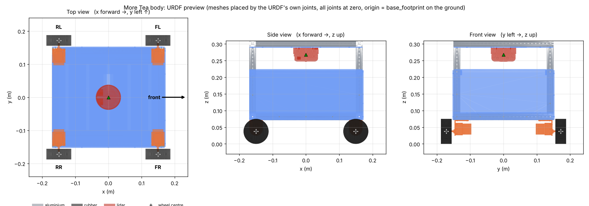

# More Tea (Garage@EEE)

ROS 2 packages for **More Tea**, the Garage@EEE delivery robot. The first package is the robot description (URDF) of the navigation base: a 2020-aluminium frame with PETG panels, four JGB37-520 motors on mecanum wheels, and an RPLIDAR. It was generated from the Fusion 360 design *MoreTea's Body v5*.



## Repo layout

colcon finds packages in any subfolder, so the top-level folders are only for grouping. Folder and package names use no spaces or capitals, as ROS requires.

```
more-tea-in-garage/
├── description/                      robot model, used by the real robot AND by simulation
│   ├── more_tea_base_description/    ✅ navigation base: URDF, meshes, RViz launch, Fusion tools
│   ├── more_tea_neck_description/    planned: neck
│   ├── more_tea_arm_description/     planned: manipulator
│   └── more_tea_description/         planned: joins base + neck + arm into one robot (xacro)
├── simulation/more_tea_gazebo/       planned: Gazebo worlds, mecanum-drive + lidar plugins
├── navigation/more_tea_navigation/   planned: Nav2 params, maps
├── manipulation/more_tea_moveit_config/  planned: from the MoveIt Setup Assistant
└── bringup/more_tea_bringup/         planned: launch files for the real robot
```

Add a folder when someone starts that part. Each subteam owns its own package, so subteams don't edit each other's files.

Details of the base package (frames, how each Fusion joint maps to the URDF, what was verified) are in [`description/more_tea_base_description/README.md`](description/more_tea_base_description/README.md). Every part's position is in [`JOINT_TABLE.md`](description/more_tea_base_description/docs/JOINT_TABLE.md).

---

## Guide

### 1. Get it running in RViz (about 10 minutes)

You need Ubuntu 24.04 with ROS 2 Jazzy. Humble on 22.04 should work too: the package only uses standard URDF and launch features. Neither has been tested on a real ROS install yet, so whoever runs this first, please report back.

```bash
# make a workspace (skip if you already have one)
mkdir -p ~/more_tea_ws/src && cd ~/more_tea_ws/src
git clone https://github.com/Aqid2108/more-tea-in-garage.git

# install the dependencies listed in package.xml, then build
cd ~/more_tea_ws
rosdep install --from-paths src --ignore-src -y
colcon build --symlink-install
source install/setup.bash

# view it
ros2 launch more_tea_base_description display.launch.py
```

RViz opens with the robot and a slider window. Each slider spins one wheel. Use `gui:=false` to skip the sliders.

**If it doesn't work:**
- *Meshes are missing or the robot is invisible:* you forgot `source install/setup.bash` in this terminal.
- *`Package 'more_tea_base_description' not found`:* you ran the build from the wrong folder. Run `colcon build` from `~/more_tea_ws`, not from `src`.
- *RViz shows "No transform":* set *Fixed Frame* to `base_footprint`.

### 2. Use it in your own launch file

The URDF is plain URDF, not xacro, so load the file and pass it to `robot_state_publisher`:

```python
import os
from ament_index_python.packages import get_package_share_directory
from launch_ros.actions import Node

urdf = os.path.join(get_package_share_directory('more_tea_base_description'), 'urdf', 'more_tea.urdf')
with open(urdf) as f:
    robot_description = f.read()

Node(package='robot_state_publisher', executable='robot_state_publisher',
     parameters=[{'robot_description': robot_description}])
```

Frames that navigation code expects:

| Frame | Where | Used by |
|---|---|---|
| `base_footprint` | On the ground, under the robot centre (root of the tree) | Nav2 robot frame, odometry child frame |
| `base_link` | Centre of the four wheel axles, 0.0375 m up | Body frame |
| `laser` | On the RPLIDAR spin axis | `frame_id` of the `/scan` topic |
| `*_wheel_link` | The four wheels, joints `front_left_wheel_joint` and so on | Wheel joint states |

Axes follow REP-103: x forward, y left, z up. Units are metres, kilograms and radians.

**With Linorobot2:** keep Linorobot2's own driver, odometry and Nav2 config. Use this URDF in place of its generic robot description, and set the lidar driver's `frame_id` to `laser`. Check the frame names in Linorobot2's launch files before swapping: anything they expect that isn't in the table above, such as an IMU frame, has to be added (see *Not done yet*).

### 3. Robot numbers for your config files

| Value | Number |
|---|---|
| Wheel radius | 0.0375 m |
| Wheel separation, left to right (wheel centres) | 0.3436 m |
| Wheelbase, front to back | 0.2993 m |
| Wheel layout | Mecanum, X configuration |
| Motor | JGB37-520, 12 V, 178 rpm no-load, about 140 rpm loaded |
| Top speed | About 0.55 m/s loaded. Cap navigation at about 0.4 m/s |
| Mass in the model | 9.5 kg. Wheels and RPLIDAR aren't weighed yet, see section 4 |

### 4. Change the masses

All masses live in **`description/more_tea_base_description/tools/materials.py`**:
- The 2020 extrusions use aluminium density.
- The printed panels use PETG density.
- The motors use the supplier figure of 158 g.
- The wheels and the RPLIDAR are still on Fusion's default steel, so they're far too heavy.

To fix a part, weigh it and add it to `MASS_OVERRIDES_KG` using its URDF part name, then regenerate:

```python
MASS_OVERRIDES_KG = {
    'front_left_wheel': 0.15,   # example only: use your scale reading
    ...
}
```

```bash
cd description/more_tea_base_description
python3 tools/generate_urdf.py     # rewrites urdf/, meshes/visual/, docs/JOINT_TABLE.md
python3 tools/validate_urdf.py     # must end with: ALL CHECKS PASSED
```

Commit the regenerated files along with `materials.py`. You only need Python 3 and numpy for this, not ROS.

### 5. Update it after the Fusion model changes

1. Open *MoreTea's Body* in Fusion 360.
2. Run `fusion/1_export_meshes_and_dump.py`, then `fusion/2_dump_transforms.py`. In Fusion: *Utilities → Scripts and Add-Ins*. The scripts expect the repo cloned at `~/more-tea-in-garage` on the Fusion PC; if yours is elsewhere, edit `BASE` at the top of both scripts.
3. If you added a new part, give it a URDF name in the `NAMES` table at the top of script 1.
4. Run `generate_urdf.py` and `validate_urdf.py` as in section 4.

Don't hand-edit `urdf/more_tea.urdf`. The generator overwrites it.

### 6. Not done yet

- **Gazebo simulation.** There are no Gazebo plugins yet. The next step is `simulation/more_tea_gazebo` with Gazebo Harmonic's mecanum-drive system on the four wheel joints, a lidar sensor on `laser`, and a ros_gz bridge.
- **Wheel and RPLIDAR masses.** They need weighing (section 4).
- **IMU, head, neck and bumper.** They aren't in the Fusion model this was generated from.
- **Mecanum rollers.** They aren't modelled: wheels collide as plain cylinders. That's fine for Nav2 planning, but a physics sim needs the mecanum-drive plugin to strafe.

### Who can pick up what

| Task | Needs | Time |
|---|---|---|
| Run section 1 on a ROS machine and report problems | Ubuntu + ROS 2 | 30 min |
| Weigh a wheel, a motor with its mount, and the RPLIDAR, then update `materials.py` | Kitchen scale, Python | 30 min |
| Measure rolling resistance: pull the loaded robot with a luggage scale and note the steady force | Luggage scale | 15 min |
| Build the Gazebo package | ROS 2, Gazebo Harmonic, some URDF/SDF | A few sessions |
| Add the IMU frame once its mounting position is decided | Fusion, then section 5 | 1 hour |

## License

[MIT](LICENSE) © 2026 Aqid Rafiuddin
