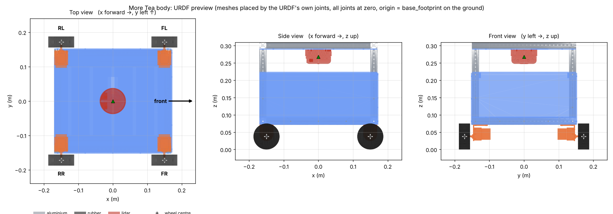

# More Tea body: navigation-base URDF (ROS 2 description package)

Four-mecanum-wheel base with a 2D LiDAR, generated from the Fusion 360 design **MoreTea's Body v5** (MORE-TEA / Navigation). One URDF link per Fusion component, so the Fusion rigid group and revolute joints are visible in the file.



## Use it
```bash
# 1. (only if the Fusion model or tools/materials.py changed) regenerate
#    Fusion: run fusion/1_export_meshes_and_dump.py, then fusion/2_dump_transforms.py
python tools/generate_urdf.py      # writes urdf/more_tea.urdf, meshes/visual/, docs/JOINT_TABLE.md
python tools/validate_urdf.py      # must end with "ALL CHECKS PASSED"

# 2. build and view (ROS 2 Jazzy; see the repo-root README for the full guide)
cd ~/more_tea_ws/src && git clone https://github.com/Aqid2108/more-tea-in-garage.git && cd ~/more_tea_ws
colcon build --symlink-install && source install/setup.bash
ros2 launch more_tea_base_description display.launch.py          # RViz + wheel sliders
```
`generate_urdf.py` needs only Python 3 + numpy. The committed `urdf/more_tea.urdf` is already generated.

## Frames and units
REP-103, metres, kg, radians. **x forward = Fusion +X, y left = Fusion -Z, z up = Fusion +Y.**

| Frame | Where |
|---|---|
| `base_footprint` | on the ground, under `base_link` (root of the tree) |
| `base_link` | centre of the four wheel axles, 0.0375 m above the ground |
| `laser` | on the RPLIDAR axis (child of `rplidar_link`), x = zero-angle direction |

## Fusion relationship → URDF
Full table with every position: **[docs/JOINT_TABLE.md](docs/JOINT_TABLE.md)** (also `data/joint_table.csv`).

| Fusion | Members | URDF |
|---|---|---|
| **Rigid Group 2** | 25 components with geometry (10 top/bottom rails, 4 posts, 5 panels, lidar holder, RPLIDAR, 4 motor mounts) | `fixed` joints from `base_link`, one per part |
| **Revolute 3** | front-right wheel ⟷ front-right motor mount | `front_right_wheel_joint`, continuous, axis `0 1 0` |
| **Revolute 4** | rear-right wheel ⟷ rear-right motor mount | `rear_right_wheel_joint`, continuous, axis `0 1 0` |
| **Revolute 5** | rear-left wheel ⟷ rear-left motor mount | `rear_left_wheel_joint`, continuous, axis `0 1 0` |
| **Revolute 6** | front-left wheel ⟷ front-left motor mount | `front_left_wheel_joint`, continuous, axis `0 1 0` |

Wheel centres in `base_link`: x = ±0.1497 m, y = ±0.1718 m, z = 0. Wheel radius 0.0375 m, width 0.032 m. A positive wheel velocity drives the robot forward.

## Simulation model
- `base_link` carries the aggregate inertial of the whole rigid group (computed from Fusion's per-part tensors) and one box collision; the part links are visual-only frames. Each wheel has its own inertial and a cylinder collision.
- Meshes are in metres, referenced as `package://more_tea_base_description/meshes/visual/...` (12 files, 2.4 MB).
- Mecanum rollers are **not** modelled: wheels are plain cylinders. Four mirrored wheel meshes are exported (X-configuration).

## Verified
`tools/validate_urdf.py`: unique names, single-root connected tree, valid inertias, rigid group → fixed and revolute → continuous mapping, every mesh lands on Fusion's own bounding box (worst deviation 0.03 mm), whole-robot mass / COM / inertia re-derived from Fusion's volumes and tensors with the materials in `tools/materials.py`.
Also loaded in MuJoCo with strict inertia checks: it settles on its four wheels at the right height, and all wheels at +8 rad/s drive it 0.89 m forward in 3 s (ideal 0.90) with no sideways drift or yaw.
**Not tested:** RViz, `colcon build`, Gazebo. No Gazebo plugins (mecanum drive, lidar sensor) are included yet.

## Check these before relying on it
1. **Masses are partly real.** Fusion has every body on default *Steel*; `tools/materials.py` reassigns them. 2020 rails/posts = aluminium 6063 (2.70 g/cm³, 1.49 kg total); panels + lidar holder = printed PETG (1.27 g/cm³ at `PRINT_FILL = 1.0`, 1.67 kg). The motors are set to 158 g each (JGB37-520, 12 V, 178 rpm, 1:56, supplier figure) in `MASS_OVERRIDES_KG`. The **wheels and RPLIDAR are still Steel** (4.44 + 1.30 kg), so the model weighs 9.5 kg. Weigh those (and ideally the printed panels, or take the slicer weight) and add them to `MASS_OVERRIDES_KG` in `tools/materials.py`, then re-run `generate_urdf.py` and `validate_urdf.py`; inertia rescales automatically.
2. **Front is assumed to be Fusion +X.** Only the `fb_side_panel` and the lidar zero-angle depend on it; the base is symmetric.
3. **Laser frame** height is mid-height of the RPLIDAR unit (approximate), and its zero-angle is assumed to point forward.
4. **Wheel axes come from the wheel geometry**, not from Fusion: the design is non-parametric (direct modelling), so Fusion's API cannot return joint origins, axes or limits. The wheels are unlimited (continuous).
5. `Lidar Holder (Assembly) v4` is an **empty component** in the rigid group. It is skipped; safe to delete in Fusion.
6. Not modelled yet: IMU, the head / neck / bumper.
7. `package.xml` license is still `TODO` - pick one (e.g. MIT, Apache-2.0) before sharing outside the club.
